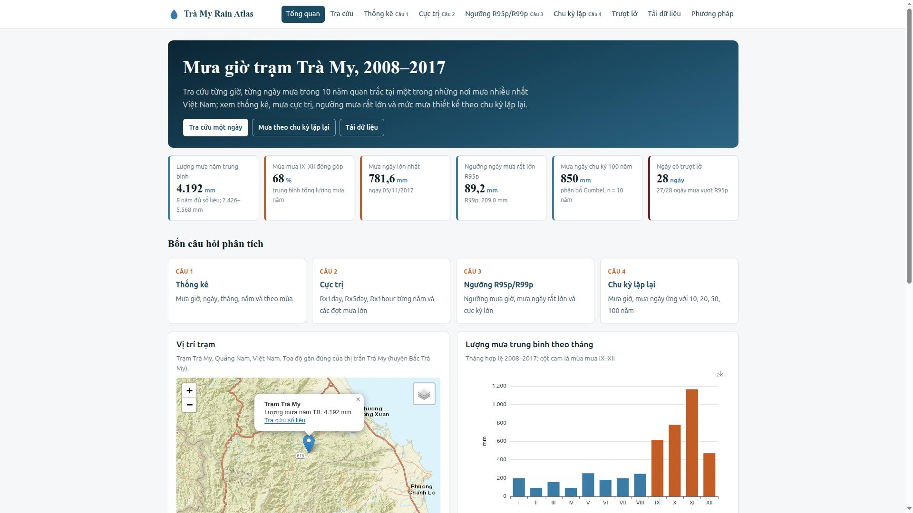
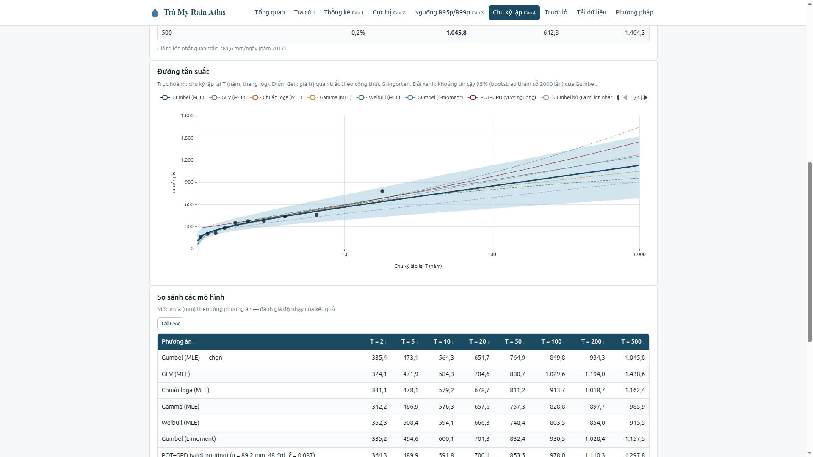

# Trà My Rain Atlas

Website tra cứu và phân tích mưa giờ **trạm Trà My (Quảng Nam)**, giai đoạn **01/01/2008 – 31/12/2017**.

**Xem website:** https://huyduong5.github.io/tra-my-rain-atlas/



## Website có gì

| Trang | Nội dung |
|---|---|
| [Tổng quan](https://huyduong5.github.io/tra-my-rain-atlas/#/) | Số liệu chính, bản đồ trạm, đợt mưa lớn nhất 03–07/11/2017, mưa và trượt lở |
| [Tra cứu](https://huyduong5.github.io/tra-my-rain-atlas/#/tra-cuu?ngay=2017-11-05) | Chọn một ngày bất kỳ: mưa từng giờ, lịch nhiệt 10 năm, chuỗi mưa ngày, tải CSV |
| [Thống kê (Câu 1)](https://huyduong5.github.io/tra-my-rain-atlas/#/thong-ke) | Thống kê mưa giờ, ngày, tháng, năm, mùa; lọc theo khoảng năm |
| [Cực trị (Câu 2)](https://huyduong5.github.io/tra-my-rain-atlas/#/cuc-tri) | Rx1day, Rx5day, Rx1hour từng năm, biểu đồ từng đợt mưa |
| [Ngưỡng R95p/R99p (Câu 3)](https://huyduong5.github.io/tra-my-rain-atlas/#/nguong) | Ngưỡng mưa giờ, mưa ngày rất lớn và cực kỳ lớn; công cụ tra phân vị |
| [Chu kỳ lặp (Câu 4)](https://huyduong5.github.io/tra-my-rain-atlas/#/chu-ky) | Mưa theo chu kỳ 2–500 năm, khoảng tin cậy 95%, 5 phân bố + POT; quy đổi T và mm |
| [Trượt lở](https://huyduong5.github.io/tra-my-rain-atlas/#/truot-lo) | 28 ngày trượt lở so với mưa ngày, mưa tích lũy 5 ngày và ngưỡng R95p/R99p |
| [Tải dữ liệu](https://huyduong5.github.io/tra-my-rain-atlas/#/tai-du-lieu) | CSV/JSON mưa giờ, ngày, tháng, năm, chỉ số và kết quả phân tích |
| [Phương pháp](https://huyduong5.github.io/tra-my-rain-atlas/#/phuong-phap) | Quy tắc kiểm tra số liệu, định nghĩa chỉ số, công thức, tài liệu tham khảo |

Mọi trang đều có đường link chia sẻ được (ví dụ link trên trỏ thẳng tới ngày 05/11/2017), bảng sắp xếp được, nút tải CSV và nút lưu ảnh biểu đồ. Giao diện dùng được trên điện thoại.

<p>
  
  
</p>

## Kết quả chính

| Chỉ tiêu | Giá trị |
|---|---|
| Lượng mưa năm trung bình (8 năm đủ số liệu) | 4 192,5 mm |
| Mùa mưa IX–XII đóng góp | khoảng 68% lượng mưa năm |
| Mưa ngày lớn nhất (Rx1day) | 781,6 mm ngày 05/11/2017 |
| Mưa 5 ngày lớn nhất (Rx5day) | 1 255,4 mm (03–07/11/2017) |
| R95p / R99p mưa giờ | 20,1 / 39,4 mm/giờ |
| R95p / R99p mưa ngày | 89,2 / 209,0 mm/ngày |
| Mưa giờ chu kỳ 10 / 20 / 50 / 100 năm (Gumbel) | 85,0 / 94,0 / 105,8 / 114,5 mm |
| Mưa ngày chu kỳ 10 / 20 / 50 / 100 năm (Gumbel) | 564,3 / 651,7 / 764,9 / 849,8 mm |

Chuỗi cực đại năm chỉ có 10 năm nên các mức 50–100 năm là ngoại suy xa, chỉ dùng tham khảo.

## Công nghệ

- **Không cần máy chủ, không có bước build:** HTML, CSS, JavaScript ES modules
- **Biểu đồ:** [Apache ECharts](https://echarts.apache.org/) 5.5.1 · **Bản đồ:** [Leaflet](https://leafletjs.com/) 1.9.4 (thư viện lưu sẵn trong `vendor/`), ảnh nền Esri (mặc định), OpenTopoMap, OpenStreetMap
- **Cập nhật không bị cache cũ:** mỗi lần triển khai, CI gắn mã commit vào đường dẫn các file JS/CSS/JSON
- **Dữ liệu:** tính bằng Python 3.12 (pandas, numpy, scipy), xuất JSON gọn (khoảng 0,5 MB)
- **Triển khai:** GitHub Actions kiểm tra dữ liệu (`scripts/validate_data.py`) rồi đưa lên GitHub Pages sau mỗi lần push vào nhánh `main`

## Cấu trúc thư mục

```
index.html, 404.html          Trang web
assets/css, assets/js         Giao diện; assets/js/pages/ là 9 trang
vendor/                       ECharts, Leaflet
data/                         JSON cho website, data/hourly/ (mưa giờ theo năm),
                              data/csv/ (bảng tải về), data/raw/ (số liệu gốc)
scripts/build_data.py         Tính toàn bộ dữ liệu cho website
scripts/validate_data.py      Kiểm tra dữ liệu (chạy trong CI)
analysis/                     Chương trình phân tích dùng chung với báo cáo
bao-cao/                      Mã LaTeX báo cáo (XeLaTeX, dùng được trên Overleaf)
.github/workflows/deploy.yml  Kiểm tra + triển khai GitHub Pages
```

## Báo cáo

Thư mục [`bao-cao/`](bao-cao/) chứa mã LaTeX đầy đủ của báo cáo *Phân tích dữ liệu mưa giờ tại trạm quan trắc Trà My giai đoạn 2008–2017* (4 câu hỏi phân tích, mục giới thiệu website, phụ lục có mã QR dẫn tới website và repo).

- Biên dịch trên Overleaf: nén thư mục `bao-cao/` thành zip → **New Project → Upload Project**; trình biên dịch XeLaTeX đã cấu hình sẵn trong `latexmkrc`.
- Biên dịch trên máy có TeX Live: `cd bao-cao && latexmk -xelatex main.tex`.
- Bảng (`bao-cao/tables/`) và hình (`bao-cao/figures/fig*.png`) được sinh bởi `python3 analysis/report_analysis.py`.

## Chạy trên máy

```bash
python3 -m http.server 8000
# mở http://localhost:8000
```

## Cập nhật dữ liệu

```bash
pip install pandas numpy scipy matplotlib
python3 scripts/build_data.py      # tính lại data/ (khoảng 1–2 phút, có bootstrap)
python3 scripts/validate_data.py   # kiểm tra
git add data && git commit -m "Cập nhật dữ liệu" && git push
```

Sau khi push, GitHub Actions tự triển khai; website cập nhật sau 1–2 phút.

## Gắn tên miền riêng (khi cần)

1. Mua tên miền, ví dụ `tramyrain.vn`.
2. Trong repo: **Settings → Pages → Custom domain**, nhập tên miền (GitHub tạo file `CNAME`).
3. Tại nhà cung cấp tên miền, tạo bản ghi DNS:
   - tên miền gốc: 4 bản ghi `A` trỏ tới `185.199.108.153`, `185.199.109.153`, `185.199.110.153`, `185.199.111.153`;
   - hoặc tên miền con `www`: bản ghi `CNAME` trỏ tới `huyduong5.github.io`.
4. Đợi DNS cập nhật rồi bật **Enforce HTTPS**.

## Nguồn dữ liệu và giấy phép

- Số liệu mưa giờ trạm Trà My 2008–2017 (tệp `Hourly rain in Tra My.xlsx - TM_1hr.csv`), dùng cho mục đích học tập. Khi dùng lại, ghi rõ nguồn và đơn vị cung cấp số liệu gốc.
- Mã nguồn: giấy phép MIT (xem `LICENSE`).
- Thực hiện: **Dương Quang Huy** — ngành Khoa học dữ liệu, khóa 68. Giáo viên hướng dẫn: **GS. Đỗ Văn Đức**.
